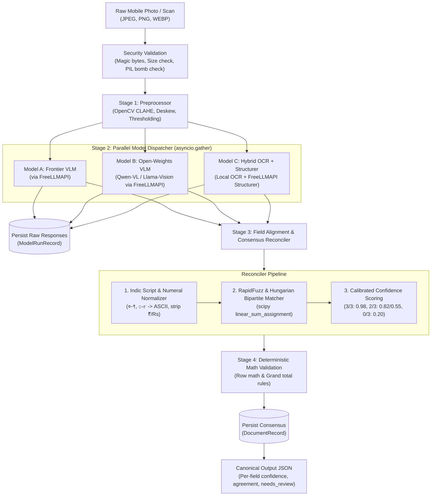

# Paper-to-Structured-Data Engine

A production-grade **Multi-Model Consensus OCR & Document Extraction Engine** tailored for messy, real-world handwritten documents (Indian local business *khatas*/ledgers, medical prescriptions, and stamped/handwritten invoices containing English and mixed regional scripts like Devanagari/Marathi/Kannada/Hindi alongside English numerals).

Built with **FastAPI**, **Pydantic v2**, **OpenCV**, and an abstract multi-model gateway connecting to **FreeLLMAPI** (local proxy router) instead of single-vendor API lock-in.

---

## Architecture Overview



---

## Core Capabilities (Phase 1)

1. **Local FreeLLMAPI Integration:** Dispatches requests to the local FreeLLMAPI router (`http://127.0.0.1:3001/v1`), leveraging free upstream providers (OpenRouter, Ollama) without hardcoded vendor lock-in.
2. **Computer Vision Preprocessing:**
   - Auto-perspective deskewing using Hough line angle detection.
   - Contrast Limited Adaptive Histogram Equalization (CLAHE) on LAB color space to eliminate uneven lighting and shadows.
   - Adaptive Gaussian thresholding buffer for faint ink recovery.
3. **Graceful Multi-Model Degradation:**
   - Executes 3 distinct vision models concurrently via `asyncio.gather()`.
   - If 1 model fails or times out, the pipeline seamlessly degrades to 2-model consensus with a `-0.10` confidence penalty without crashing.
4. **Hungarian Bipartite Row Alignment:**
   - Pairs line-item rows across models using `scipy.optimize.linear_sum_assignment` on `RapidFuzz` similarity matrices, even when models extract rows in scrambled order.
5. **Deterministic Arithmetic Verification (Zero LLM Math Trust):**
   - Row-level rule: `abs((qty * unit_price) - line_total) <= 0.05`
   - Document-level rule: `abs((sum(line_totals) + tax - discount) - grand_total) <= 0.50`
   - Discrepancies automatically cap field confidence to `<= 0.45` and route to `NEEDS_REVIEW`.
6. **Immutable Raw Output Preservation:** Verbatim raw model outputs are saved in the database before reconciliation for continuous evaluation and leaderboards.

---

## Quickstart

### 1. Environment Setup

Ensure Python 3.11+ and Node.js are installed.

```powershell
# Create and activate virtual environment
python -m venv backend/.venv
.\backend\.venv\Scripts\Activate.ps1

# Install pinned dependencies
pip install -r backend/requirements.txt
```

### 2. Configure FreeLLMAPI Gateway

Run the auto-configuration utility to detect your existing FreeLLMAPI installation, extract the unified API key, and populate `backend/.env`:

```powershell
python scripts/setup_freellmapi.py
```

To start the local FreeLLMAPI router on port 3001:
```powershell
.\scripts\start_freellm.ps1
```

### 3. Run Automated Tests

Run the full pytest suite with coverage:
```powershell
pytest backend/tests -v --cov=backend/app --cov-report=term-missing
```

Check code quality with Ruff:
```powershell
ruff check backend/
```

### 4. Start the Frontend Review Studio

```powershell
cd frontend
npm install
npm run dev
```

The split-screen studio will be available at **http://localhost:5173**.
- **Zoomable/Pannable Document Canvas:** Pan, zoom, rotate, and toggle high-contrast CLAHE filters on the left sidecar.
- **Interactive Multi-Model Inspector:** Inspect individual predictions from Model A (Frontier VLM), Model B (Qwen-VL), and Model C (Hybrid OCR) with 1-click adoption.
- **Deterministic Row Math Audit:** Live verification indicator highlighting row calculation discrepancies (`abs(qty * price - total) <= 0.05`) with 1-click arithmetic auto-fix.
- **HITL Verification:** Submits golden ground truth to the continuous evaluation engine via `POST /api/v1/documents/{id}/verify`.
- **Benchmark Leaderboard:** View live accuracy, CER, and math discrepancy rates across models.

---

### 5. Start the Backend API

```powershell
uvicorn backend.app.main:app --host 127.0.0.1 --port 8000 --reload
```

- **Swagger Documentation:** [http://127.0.0.1:8000/docs](http://127.0.0.1:8000/docs)
- **Health Endpoint:** [http://127.0.0.1:8000/api/v1/health](http://127.0.0.1:8000/api/v1/health)
- **FreeLLMAPI Connectivity:** [http://127.0.0.1:8000/api/v1/health/freellmapi](http://127.0.0.1:8000/api/v1/health/freellmapi)

---

## API Usage Example

Extract data from an invoice:

```powershell
curl.exe -X POST "http://127.0.0.1:8000/api/v1/extract" `
  -F "file=@sample_dataset/sample_invoice.png" `
  -F "doc_type=INVOICE"
```

Response payload format:
```json
{
  "document_id": "42616f72-7a2e-4b95-a481-c750e3b6924b",
  "document_type": "INVOICE",
  "overall_confidence": 0.98,
  "status": "PROCESSED",
  "math_validation": {
    "is_valid": true,
    "discrepancy_amount": 0.0,
    "error_details": []
  },
  "fields": {
    "vendor_name": {
      "value": "SHREE GANESH GENERAL STORES",
      "confidence": 0.98,
      "agreement": "3/3",
      "candidates": {
        "gemini_vlm": "SHREE GANESH GENERAL STORES",
        "qwen_vl": "SHREE GANESH GENERAL STORES",
        "hybrid_ocr": "SHREE GANESH GENERAL STORES"
      },
      "needs_review": false
    },
    "grand_total": {
      "value": 1400.0,
      "confidence": 0.98,
      "agreement": "3/3",
      "candidates": {
        "gemini_vlm": 1400.0,
        "qwen_vl": 1400.0,
        "hybrid_ocr": 1400.0
      },
      "needs_review": false
    }
  },
  "line_items": [
    {
      "row_id": 1,
      "description": { "value": "Atta Premium 5kg", "confidence": 0.98, "needs_review": false },
      "quantity": { "value": 2.0, "confidence": 0.98, "needs_review": false },
      "unit_price": { "value": 240.0, "confidence": 0.98, "needs_review": false },
      "line_total": { "value": 480.0, "confidence": 0.98, "row_math_valid": true, "needs_review": false }
    }
  ]
}
```

---

## Security Compliance

- **OWASP API Security:** Strict MIME sniffing using magic bytes (`filetype`), rejection of non-images, maximum upload size capping (10MB), and PIL decompression bomb protection (`Image.MAX_IMAGE_PIXELS`).
- **Zero Credential Exposure:** Unified router keys and sensitive configurations are managed via `.env` and `pydantic-settings`. No credentials are printed or returned in API responses.
- **Auditability:** Verbatim raw model responses are stored permanently in the database to guarantee reproducibility and auditability.
